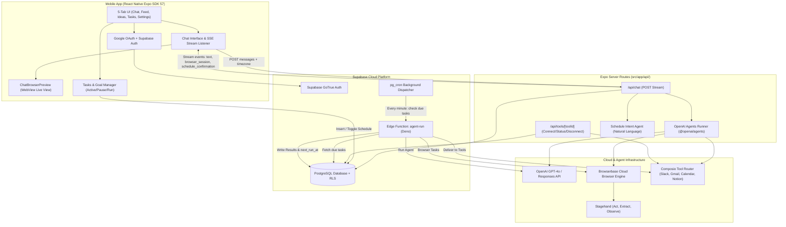

# 🌟 Muse AI Clone — Master Architecture & Implementation Plan

> **Reference Video:** [How to Build a Muse AI Agent Clone Mobile App – React Native Expo Full Stack Tutorial](https://www.youtube.com/watch?v=ZOFVRjbB_xk)  
> **Channel:** TubeGuruji  
> **Duration:** 3 hours 58 minutes (14,292 seconds)  
> **Target Application:** Autonomous AI Agent & Mobile Companion (Cooper / Muse AI)  
> **Target Platform:** Universal Mobile (iOS & Android via React Native Expo) + Web

---

## 📑 Executive Summary

This Master Plan defines the comprehensive end-to-end architecture, development phases, and integration milestones for building **Muse AI Clone** — an autonomous agent mobile application inspired by Meta's Muse AI and featuring companion agent **Cooper**.

Unlike standard chat applications, Muse AI is an **agentic system** capable of:
1. **Multi-turn Contextual Conversation:** Natural streaming chat with session memory and multi-chat management (Main vs. Side chats).
2. **Autonomous Cloud Web Browsing:** Live web browsing and multi-step action execution via **Browserbase** and **Stagehand** with real-time in-app WebView streaming.
3. **Cross-Platform Tool Integrations:** Real-world tool execution (Gmail, Slack, Google Calendar, Notion, GitHub, Reddit) powered by **Composio** and the **OpenAI Agents SDK**.
4. **Autonomous Scheduled Routines & Goals:** Background cron-triggered task execution using **Supabase Edge Functions** (`agent-run`) and PostgreSQL `pg_cron`, delivering results into chat threads or external channels (Slack/Email).

---

## 🏗️ System Architecture & Data Flow



---

## 🧩 Video Breakdown & Curriculum Phases

The tutorial video spans nearly 4 hours organized into 10 structured operational modules:

| Timestamp | Video Module | Core Technical Focus |
|---|---|---|
| **00:00:00** | Introduction | Architectural overview of Meta's Muse AI, autonomous agents, and mobile companion vision. |
| **00:01:42** | Application Demo | Demonstration of live app: peach/gray chat bubbles, live cloud browser iframe preview, tool connectors, recurring tasks manager. |
| **00:06:18** | Project Setup | Expo SDK 57, React Native 0.86, Expo Router tab routing, HugeIcons, Android Studio SDK, emulator configuration. |
| **00:21:27** | Database & Authentication | Supabase setup, Google Cloud OAuth 2.0 Client credentials, deep linking (`Linking.createURL`), `expo-web-browser` session handling, user profiles. |
| **00:50:17** | AI Agent Setup | `@openai/agents` framework, Cooper prompt design, tool definition schemas, streaming SSE response chunking. |
| **01:14:33** | Save Chat & Create New Chat | PostgreSQL `chat_threads` and `chat_messages` tables, RLS policies, sidebar drawer thread list, main vs. side chats. |
| **02:22:13** | Browserbase Setup | Browserbase cloud headless browser, API keys, session creation, live debugger URL generation, preview URLs. |
| **02:48:11** | Stagehand: Make Browserbase Act | `@browserbasehq/stagehand` integration, AI-driven `act()`, `extract()`, and `observe()` workflows, embedding live browser in `ChatBrowserPreview` (WebView). |
| **03:33:11** | Schedule Recurring Task | Natural language schedule intent extraction, `scheduled_agent_tasks` table, Supabase Edge Function (`agent-run`), `pg_cron` cron triggers, automated tool delivery (Slack/Gmail). |
| **03:54:09** | Wrap Up | End-to-end testing, error recovery strategies, environment variables, mobile deployment checklist. |

---

## 🛠️ Required Stack & External Dependencies

### 1. Mobile & Frontend Runtime
- **Framework:** Expo (SDK 57)
- **Runtime:** React Native 0.86.3 / React 19.2.3
- **Routing:** Expo Router (`expo-router` v57)
- **Styling & Icons:** `@hugeicons/react-native`, `@hugeicons/core-free-icons`, `react-native-svg`
- **In-App Browser:** `react-native-webview`, `expo-web-browser`, `expo-linking`
- **State & Storage:** React hooks, `@react-native-async-storage/async-storage`

### 2. Backend & Serverless API
- **Expo Router API Routes:** `src/app/api/chat+api.ts`, `src/app/api/tools/[toolId]/+api.ts`
- **Edge Runtime:** Supabase Edge Functions (Deno / TypeScript)
- **Background Cron:** PostgreSQL `pg_cron` extension

### 3. AI & Automation SDKs
- **AI Agent Framework:** `@openai/agents` (v0.1+)
- **LLM Engine:** OpenAI `gpt-4o` / Responses API
- **Cloud Browser:** `@browserbasehq/sdk`
- **Browser Automation:** `@browserbasehq/stagehand`
- **Tool Integration Layer:** `@composio/core`, `@composio/openai-agents`

### 4. Database & Auth Platform
- **Database:** Supabase PostgreSQL with Row Level Security (RLS)
- **Auth Provider:** Supabase Auth (GoTrue) + Google OAuth 2.0

---

## 🗺️ Master Roadmap & Divisible Sub-Plans

To ensure smooth, error-free implementation by a coding agent, the project is structured into **7 divisible, sequential sub-plans** located in `docs/`:

```
docs/
├── 00_MASTER_PLAN.md                                  # This master blueprint & system overview
├── 01_ENVIRONMENT_AND_SETUP.md                       # Environment, dependencies, API keys, and emulators
├── 02_SUBPLAN_DATABASE_AND_AUTH.md                   # Supabase schema, RLS, Google OAuth, session management
├── 03_SUBPLAN_AI_AGENT_CORE.md                       # OpenAI Agents SDK, API routes, streaming SSE, chat persistence
├── 04_SUBPLAN_BROWSERBASE_AND_STAGEHAND.md           # Cloud browser sessions, Stagehand automation, WebView preview
├── 05_SUBPLAN_COMPOSIO_TOOL_INTEGRATIONS.md          # Composio Tool Router, Connectors UI, Slack/Gmail/Calendar
├── 06_SUBPLAN_SCHEDULED_AGENT_TASKS.md               # Schedule parser, Edge Function agent-run, pg_cron, delivery
└── 07_SUBPLAN_PRODUCTION_POLISH_AND_DEPLOYMENT.md    # Ideas tab, Feed tab, error hardening, EAS mobile build
```

---

## 🎯 Verification & Acceptance Strategy

Each sub-plan contains independent **Acceptance Criteria** and **Step-by-Step Verification Checklists**. 

### Global Project Milestone Gates:
1. **Gate 1 (Auth & DB):** User can sign in with Google on device/emulator, session is securely stored in Supabase, and user row is validated.
2. **Gate 2 (AI Conversation):** User can send messages to Cooper in `/(tabs)/chat`, receiving streamed token responses with conversational memory.
3. **Gate 3 (Cloud Web Browsing):** When asked to search or interact with a website, Cooper launches Browserbase, executes actions via Stagehand, and displays the live browser window inside the chat bubble.
4. **Gate 4 (Third-Party Tools):** User can connect Gmail/Slack via Settings Connectors, and Cooper can fetch or send emails/messages upon command.
5. **Gate 5 (Scheduled Autonomous Tasks):** When asked "Check Hacker News every morning at 9 AM and post to Slack", Cooper presents a confirmation card; upon confirmation, the task is saved and successfully executed by the Supabase Edge Function via cron.
