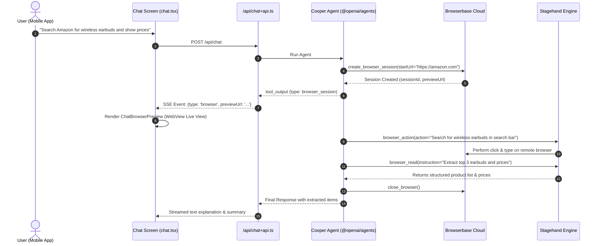

# 🌐 Sub-Plan 03 — Autonomous Cloud Browsing (Browserbase & Stagehand)

> **Document:** `docs/04_SUBPLAN_BROWSERBASE_AND_STAGEHAND.md`  
> **Parent Plan:** [`docs/00_MASTER_PLAN.md`](./00_MASTER_PLAN.md)  
> **Video Alignment:** Chapters `02:22:13 Browserbase Setup` and `02:48:11 Stagehand : Make Browserbase Act`

---

## 🎯 Objective & Scope

Equip Cooper with true web agency. Mobile devices cannot run Chromium or Playwright natively due to sandbox constraints. We solve this by launching headless cloud browser instances on **Browserbase**, directing the browser using **Stagehand**'s AI-powered natural language action engine, and streaming the live cloud browser view directly into the mobile chat bubble via `react-native-webview`.

---

## 🏗️ Architecture & Component Flow



---

## 🛠️ Implementation Details

### 1. Browserbase & Stagehand Client Provider (`src/lib/browserbase.ts`)

```typescript
import Browserbase from "@browserbasehq/sdk";
import fs from "fs";
import path from "path";
import WebSocket from "ws";

if (!globalThis.WebSocket) {
  globalThis.WebSocket = WebSocket as unknown as typeof globalThis.WebSocket;
}

export const GetBrowserbase = () => {
  const apiKey = process.env.BROWSERBASE_API_KEY;
  if (!apiKey) throw new Error("BROWSERBASE_API_KEY is missing");
  return new Browserbase({ apiKey });
};

export const createBrowser = async () => {
  const apiKey = process.env.BROWSERBASE_API_KEY;
  const projectId = process.env.BROWSERBASE_PROJECT_ID;
  const openaiApiKey = process.env.OPENAI_API_KEY;

  if (!apiKey || !projectId || !openaiApiKey) {
    throw new Error("Missing required Browserbase or OpenAI keys");
  }

  const { browserbase, Stagehand } = await import("@browserbasehq/stagehand");

  // Launch cloud browser session
  const browser = await browserbase.launch({
    apiKey,
    projectId,
    keepAlive: false,
  });

  // Attach Stagehand AI automation layer
  const stagehand = await Stagehand.create({
    browser,
    model: {
      modelName: "openai/gpt-4o",
      apiKey: openaiApiKey,
    },
    selfHeal: true,
  });

  return { browser, stagehand };
};
```

### 2. Browser Tools Definition (`src/services/tools/BrowserbaseSession.ts`)

Define the 5 core tools used by `@openai/agents`:

1. `create_browser_session`:
   - Parameters: `startUrl: string`, `reason: string`
   - Executes: Launches Browserbase browser, navigates to `startUrl`, stores session in memory store, returns `{ type: 'browser_session', sessionId, previewUrl }`.
2. `browser_navigate`:
   - Parameters: `url: string`
   - Executes: Navigates existing page to URL.
3. `browser_action`:
   - Parameters: `action: string` (e.g., "Click on the first search result", "Type iPhone into the search input")
   - Executes: `stagehand.act(action)` using AI vision and selector healing.
4. `browser_read`:
   - Parameters: `instruction: string`
   - Executes: `stagehand.extract(instruction)` returning clean text/JSON representation.
5. `close_browser`:
   - Parameters: `sessionId: string`
   - Executes: Terminates the remote Browserbase session.

### 3. In-App Live Browser View (`src/components/common/ChatBrowserPreview.tsx`)

Render an embedded preview container directly inside the message bubble when a `browser_session` is active:

```tsx
import React from "react";
import { View, StyleSheet, TouchableOpacity, Text, ActivityIndicator } from "react-native";
import { WebView } from "react-native-webview";
import * as WebBrowser from "expo-web-browser";
import { Colors } from "@/constants/colors";

interface Props {
  previewUrl: string;
}

export function ChatBrowserPreview({ previewUrl }: Props) {
  if (!previewUrl) return null;

  return (
    <View style={styles.container}>
      <WebView
        source={{ uri: previewUrl }}
        style={styles.webview}
        javaScriptEnabled
        domStorageEnabled
        startInLoadingState
        renderLoading={() => (
          <View style={styles.loading}>
            <ActivityIndicator color={Colors.primary} />
          </View>
        )}
      />
      <TouchableOpacity
        style={styles.openBtn}
        onPress={() => WebBrowser.openBrowserAsync(previewUrl)}
        activeOpacity={0.8}
      >
        <Text style={styles.openBtnText}>Open Full Interactive Browser</Text>
      </TouchableOpacity>
    </View>
  );
}

const styles = StyleSheet.create({
  container: {
    height: 260,
    marginTop: 10,
    borderRadius: 12,
    overflow: "hidden",
    borderWidth: 1,
    borderColor: "#E2E8F0",
    backgroundColor: "#F8FAFC",
  },
  webview: {
    flex: 1,
  },
  loading: {
    ...StyleSheet.absoluteFillObject,
    alignItems: "center",
    justifyContent: "center",
    backgroundColor: "#F8FAFC",
  },
  openBtn: {
    backgroundColor: Colors.primary,
    paddingVertical: 8,
    alignItems: "center",
  },
  openBtnText: {
    color: "#FFFFFF",
    fontSize: 12,
    fontWeight: "600",
  },
});
```

---

## ✅ Acceptance Criteria & Testing Checklist

- [ ] Ask Cooper: "Open wikipedia.org and search for Apollo 11".
- [ ] Cooper triggers `create_browser_session` with `startUrl: "https://wikipedia.org"`.
- [ ] Real-time SSE event arrives at mobile client with `type: 'browser'` and a valid `previewUrl`.
- [ ] Mobile chat renders `ChatBrowserPreview` component showing Wikipedia loading in the WebView.
- [ ] Stagehand clicks the search bar and types "Apollo 11".
- [ ] Stagehand reads the summary and Cooper finishes with the exact factual answer.
- [ ] Cloud browser closes upon conclusion without hanging sessions.
