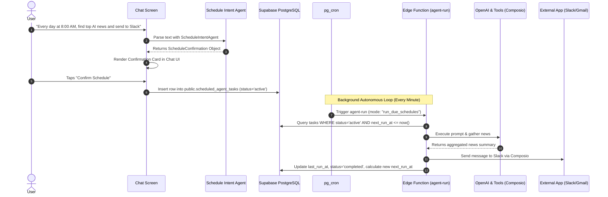

# ⏰ Sub-Plan 05 — Autonomous Scheduled Tasks & Background Cron Dispatcher

> **Document:** `docs/06_SUBPLAN_SCHEDULED_AGENT_TASKS.md`  
> **Parent Plan:** [`docs/00_MASTER_PLAN.md`](./00_MASTER_PLAN.md)  
> **Video Alignment:** Chapter `03:33:11 Schedule Recurring Task`

---

## 🎯 Objective & Scope

Empower Cooper to operate autonomously in the cloud even when the mobile app is closed or the user's phone is asleep. This phase introduces:
1. Natural language schedule intent extraction from chat utterances.
2. In-chat confirmation card with 1-tap scheduling.
3. Dedicated **Tasks Tab** management for active/paused routines and manual trigger runs.
4. Serverless **Supabase Edge Function** (`agent-run`) orchestrated by PostgreSQL `pg_cron`.
5. Automated multi-channel delivery (chat, Slack, Gmail, Notion).

---

## 🏗️ End-to-End Autonomous Lifecycle



---

## 🛠️ Implementation Details

### 1. Schedule Intent Parsing (`src/lib/scheduleIntentAgent.ts`)

Extract scheduling intent and recurring frequency rules from conversational queries:

```typescript
import OpenAI from "openai";

export async function parseScheduleIntentWithAgent({
  text,
  timezone = "UTC",
}: {
  text: string;
  timezone?: string;
}) {
  const openai = new OpenAI({ apiKey: process.env.OPENAI_API_KEY });

  const prompt = `
Extract scheduling intent from the user message.
User Message: "${text}"
Current Timezone: "${timezone}"

If the user wants to schedule a task or recurring routine, output JSON matching:
{
  "isSchedule": true,
  "title": "Brief title of the task",
  "frequency": "daily" | "weekly",
  "time": "HH:MM (24-hour format)",
  "weekday": "monday" ... "sunday" (if weekly),
  "delivery": "chat" | "slack" | "email" | "notion",
  "task": "Specific task prompt to execute"
}
If no scheduling intent is present, output: {"isSchedule": false}
`;

  const response = await openai.chat.completions.create({
    model: "gpt-4o",
    messages: [{ role: "user", content: prompt }],
    response_format: { type: "json_object" },
  });

  const parsed = JSON.parse(response.choices[0].message.content || "{}");
  if (!parsed.isSchedule) return null;

  return {
    title: parsed.title,
    originalPrompt: text,
    taskType: "generic_prompt" as const,
    taskPayload: {
      prompt: parsed.task,
      task: parsed.task,
      useOpenAi: true,
    },
    scheduleRule: {
      frequency: parsed.frequency,
      time: parsed.time,
      weekday: parsed.weekday,
    },
    timezone,
    delivery: parsed.delivery || "chat",
    summary: `${parsed.frequency === 'daily' ? 'Daily' : 'Weekly on ' + parsed.weekday} at ${parsed.time}`,
  };
}
```

### 2. Schedule Task Management Service (`src/lib/scheduledTasks.ts`)

Provides methods for the mobile client to create, list, toggle, and trigger scheduled tasks:
- `createScheduledAgentTask(userId, confirmation)`
- `fetchUserScheduledTasks(userId)`
- `toggleScheduledTaskStatus(taskId, currentStatus)`
- `runScheduledTaskNow(taskId)`: Calls Supabase Edge Function directly with `mode = "run_scheduled_task"`.

### 3. Tasks Tab Screen Enhancement (`src/app/(tabs)/tasks.tsx`)

Replace the static mock list in `tasks.tsx` with live data connected to Supabase:
- Query `public.scheduled_agent_tasks` on screen focus.
- Display task cards with:
  - Title and recurrence summary (e.g. `Daily at 09:00 AM UTC`).
  - Active/Paused `Switch` toggle.
  - Delivery badge (Chat, Slack, Email).
  - Last run status badge (`completed` with green dot, `failed` with red dot).
  - "Run Now" play button triggering immediate execution.

### 4. Supabase Edge Function (`supabase/functions/agent-run/index.ts`)

Deploy the Deno serverless edge worker to Supabase:

```typescript
// supabase/functions/agent-run/index.ts
import { serve } from "https://deno.land/std@0.168.0/http/server.ts";
import { createClient } from "https://esm.sh/@supabase/supabase-js@2.39.0";

serve(async (req) => {
  const supabase = createClient(
    Deno.env.get("SUPABASE_URL")!,
    Deno.env.get("SUPABASE_SERVICE_ROLE_KEY")!
  );

  const { mode = "run_due_schedules", taskId } = await req.json().catch(() => ({}));

  if (mode === "run_due_schedules") {
    // 1. Fetch due active tasks
    const { data: dueTasks } = await supabase
      .from("scheduled_agent_tasks")
      .select("*")
      .eq("status", "active")
      .lte("next_run_at", new Date().toISOString());

    for (const task of dueTasks || []) {
      await executeScheduledTask(supabase, task);
    }

    return new Response(JSON.stringify({ status: "success", executed: dueTasks?.length || 0 }));
  }

  if (mode === "run_scheduled_task" && taskId) {
    const { data: task } = await supabase
      .from("scheduled_agent_tasks")
      .select("*")
      .eq("id", taskId)
      .single();

    if (task) await executeScheduledTask(supabase, task);
    return new Response(JSON.stringify({ status: "success", task: taskId }));
  }

  return new Response("Invalid mode", { status: 400 });
});

async function executeScheduledTask(supabase: any, task: any) {
  try {
    // 1. Execute task via OpenAI / Tools
    const resultSummary = await runAgentLogic(task.task_payload);

    // 2. Multi-channel delivery
    if (task.delivery === 'chat') {
      // Find user's main chat thread and append message
      const { data: thread } = await supabase
        .from('chat_threads')
        .select('id')
        .eq('user_id', task.user_id)
        .eq('type', 'main')
        .single();

      if (thread) {
        await supabase.from('chat_messages').insert({
          thread_id: thread.id,
          sender: 'agent',
          text: `🔔 **Scheduled Routine: ${task.title}**\n\n${resultSummary}`,
        });
      }
    } else {
      // Execute delivery to Slack / Gmail via Composio
      await deliverToComposio(task.user_id, task.delivery, resultSummary);
    }

    // 3. Advance next_run_at and update record
    const nextRun = calculateNextRun(task.schedule_rule, task.timezone);
    await supabase.from("scheduled_agent_tasks").update({
      last_run_at: new Date().toISOString(),
      last_run_status: "completed",
      last_run_summary: resultSummary,
      next_run_at: nextRun.toISOString(),
    }).eq("id", task.id);
  } catch (err: any) {
    await supabase.from("scheduled_agent_tasks").update({
      last_run_at: new Date().toISOString(),
      last_run_status: "failed",
      last_run_error: err.message,
    }).eq("id", task.id);
  }
}
```

### 5. PostgreSQL `pg_cron` Automated Dispatcher

Run this SQL in Supabase SQL editor to schedule the cron trigger:

```sql
create extension if not exists pg_net;
create extension if not exists pg_cron;

select cron.schedule(
  'run-due-agent-tasks',
  '* * * * *', -- Run every minute
  $$
  select net.http_post(
    url := 'https://<YOUR_PROJECT_REF>.supabase.co/functions/v1/agent-run',
    headers := jsonb_build_object(
      'Content-Type', 'application/json',
      'Authorization', 'Bearer <YOUR_SERVICE_ROLE_KEY>'
    ),
    body := jsonb_build_object('mode', 'run_due_schedules')
  ) as request_id;
  $$
);
```

---

## ✅ Acceptance Criteria & Testing Checklist

- [ ] Ask Cooper: "Schedule a daily routine every day at 10:00 AM to check stock prices".
- [ ] Cooper replies with an interactive confirmation card showing recurrence and action details.
- [ ] User taps "Confirm Schedule"; task is inserted into `scheduled_agent_tasks`.
- [ ] Navigating to the **Tasks** tab displays the newly registered task with an active toggle.
- [ ] User taps the "Play" icon on the task card to trigger a manual run.
- [ ] The task status transitions to `completed`, showing summary text and timestamp.
- [ ] If delivery was set to "chat", a new message from Cooper appears in the main chat thread with the results.
- [ ] If delivery was set to "Slack", a message arrives in the user's connected Slack channel.
